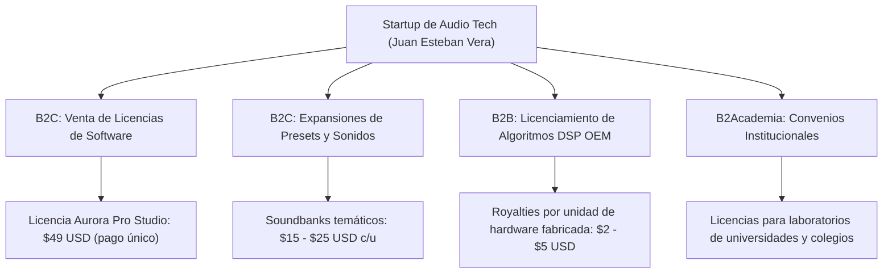

# PLAN DE NEGOCIO Y MODELO FINANCIERO: STARTUP DE AUDIO DIGITAL
## EMPRESA TECNOLÓGICA BASADA EN EL SOFTWARE "AURORA"
### Universidad Antonio Nariño · Sede Ibagué · Programa de Ingeniería Electrónica
**Documento Estratégico:** BIZ-UAN-2026-01  
**Emprendedor / Fundador:** Juan Esteban Vera Rodríguez

---

## 1. RESUMEN EJECUTIVO Y PROPÓSITO EMPRESARIAL

El presente documento establece la formulación comercial y estratégica para la creación de una **Startup de Base Tecnológica (Spin-off)** con sede en **Ibagué, Tolima**, orientada a la investigación, desarrollo y comercialización de software de procesamiento digital de señales (DSP), instrumentos virtuales de audio (VST3/AU/Standalone) y algoritmos embebidos.

El producto mínimo viable (MVP) validado es **Aurora By Juan Esteban Vera**, un sintetizador híbrido polifónico que resuelve las principales fricciones del mercado de la producción musical actual:
- Elimina el excesivo consumo de recursos de los instrumentos basados en gigabytes de muestras grabadas (*sample-based libraries*).
- Proporciona una interfaz intuitiva con el **Motion Control Super Knob**, permitiendo a productores independientes y profesionales lograr modulaciones tímbricas complejas sin requerir hardware de miles de dólares.
- Ofrece estabilidad matemática absoluta mediante modelado analógico virtual TPT y supresión de aliasing PolyBLEP.

---

## 2. ANÁLISIS DE MERCADO GLOBAL (TAM, SAM, SOM)

```text
+---------------------------------------------------------------------------------+
| TAM: Mercado Global de Software de Producción de Audio y Plugins                |
|      Valor estimado: $1.280 Millones USD (Crecimiento anual compuesto CAGR 7.8%)|
+---------------------------------------------------------------------------------+
        |
        v
+-----------------------------------------------------------------------+
| SAM: Mercado de Sintetizadores Virtuales e Instrumentos de Teclado    |
|      Valor estimado: $340 Millones USD (Productores, DJs, Compositores)|
+-----------------------------------------------------------------------+
        |
        v
+-----------------------------------------------------------------+
| SOM: Mercado Inicial Accesible (Latinoamérica + Indie Global)   |
|      Objetivo a 3 años: $1.8 Millones USD (0.5% del SAM)        |
+-----------------------------------------------------------------+
```

### 2.1. Segmentos de Clientes (Buyer Personas)
1. **Productores Musicales Independientes y Beatmakers:** Buscan herramientas accesibles, con sonidos listos para producción (*mix-ready*) y bajo consumo de CPU en computadoras portátiles.
2. **Músicos de Directo y Tecladistas:** Valoran la inmediatez del teclado de 25 teclas, el cambio rápido de presets de Yamaha y la latencia sub-10 ms en vivo.
3. **Estudiantes de Ingeniería y Conservatorios de Música:** Requieren software transparente, didáctico y sin barreras de licenciamiento invasivo.
4. **Fabricantes de Hardware Musical (OEM B2B):** Marcas de pedales y sintetizadores que buscan algoritmos DSP optimizados para microcontroladores ARM Cortex-M7 o chips DSP dedicados.

---

## 3. PROPUESTA DE VALOR Y VENTAJA COMPETITIVA

| Criterio de Comparación | Sintetizadores Comerciales Típicos (Serum, Massive, Pigments) | Aurora By Juan Esteban Vera |
|---|---|---|
| **Precio al Consumidor** | \$189 – \$249 USD | **\$49 USD (Pro) / Gratuito (Estudiantil)** |
| **Consumo de Memoria RAM** | 500 MB – 2 GB por instancia | **$< 45\text{ MB}$ por instancia** |
| **Protección Anticopia** | Invasiva (iLok / Validación constante en la nube) | **Clave de activación ligera / Cero DRM intrusivo** |
| **Control Gestual** | Automatizaciones multiparámetro complejas en DAW | **Motion Control Super Knob en tiempo real** |
| **Modo Afinador Vocal Integrado** | Requiere adquirir un plugin adicional (\$99 - \$199 USD) | **Procesador de voz y autotune granular incorporado** |
| **Portabilidad a Hardware** | Código propietario cerrado no portable | **Algoritmos matemáticos listos para embeber en C++** |

---

## 4. MODELO DE NEGOCIO Y ESTRATEGIA DE INGRESOS (REVENUE STREAMS)



1. **Modelo Freemium / Edición Comunitaria (UAN Community Edition):** Gratuita con 2 voces y presets esenciales. Actúa como motor viral de adquisición de usuarios en universidades y redes sociales.
2. **Aurora Pro Studio (\$49 USD):** Versión comercial con 16 voces, exportación MIDI, compatibilidad VST3/AU y banco completo de sonidos analógicos y FM.
3. **Packs de Expansión de Sonido (Add-ons):** Lanzamiento trimestral de paquetes temáticos de presets (*Synthwave 80s*, *Cinematic Ambient*, *Modern Urban Bass*) a un precio de \$15 USD.
4. **Licenciamiento B2B OEM:** Venta no exclusiva del motor DSP vectorizado para integración en hardware embebido musical (pedales, módulos Eurorack, sintetizadores portátiles).

---

## 5. PROYECCIÓN FINANCIERA A 3 AÑOS (EN USD)

### 5.1. Supuestos Operativos
- Tasa de conversión de usuarios gratuitos a Pro: $2.8\%$.
- Crecimiento mensual compuesto de tráfico: $12\%$.
- Canales de distribución digital: Tienda propia (Shopify / FastSpring), Plugin Boutique, KVR Audio y Splice.

| Rubro Financiero | Año 1 (Lanzamiento) | Año 2 (Expansión) | Año 3 (Consolidación) |
|---|---|---|---|
| **Usuarios Gratuitos Registrados** | 25.000 | 120.000 | 450.000 |
| **Licencias Pro Vendidas (\$49)** | 700 unidades | 3.360 unidades | 12.600 unidades |
| **Ingresos por Licencias Pro** | \$34.300 USD | \$164.640 USD | \$617.400 USD |
| **Ingresos por Expansiones / Presets** | \$4.500 USD | \$32.000 USD | \$145.000 USD |
| **Ingresos por Licenciamiento B2B OEM** | \$10.000 USD | \$45.000 USD | \$120.000 USD |
| **INGRESOS TOTALES BRUTOS** | **\$48.800 USD** | **\$241.640 USD** | **\$882.400 USD** |
| Costos Operativos y Servidores (OpEx) | \$9.500 USD | \$28.000 USD | \$75.000 USD |
| Marketing Digital y Campañas | \$12.000 USD | \$45.000 USD | \$130.000 USD |
| Nómina y Desarrollo de Ingeniería | \$18.000 USD | \$65.000 USD | \$190.000 USD |
| **UTILIDAD NETA ANTES DE IMPUESTOS** | **\$9.300 USD** | **\$103.640 USD** | **\$487.400 USD** |

**Punto de Equilibrio (Break-Even Point):** Se alcanza en el **mes 8** de operaciones comerciales, requiriendo un volumen mínimo de 38 licencias mensuales para cubrir los costos fijos iniciales de infraestructura en la nube y marketing.

---

## 6. ESTRATEGIA DE PROPIEDAD INTELECTUAL (IP) EN COLOMBIA

Para blindar el valor de la empresa ante inversores y socios estratégicos, se implementará un proceso de protección jurídica en dos fases:

1. **Registro de Obra de Software ante la DNDA (Dirección Nacional de Derecho de Autor):**
   - Depósito formal del código fuente íntegro de [`synth/engine.py`](file:///c:/Users/juane/OneDrive/Desktop/sintentizador/synth/engine.py), [`synth/app.py`](file:///c:/Users/juane/OneDrive/Desktop/sintentizador/synth/app.py) y arquitectura de presets, protegiendo los derechos morales y patrimoniales a nombre de **Juan Esteban Vera Rodríguez**.
2. **Registro de Signo Distintivo y Marca ante la SIC (Superintendencia de Industria y Comercio):**
   - Solicitud de registro de la marca comercial **AURORA SYNTHESIZERS** y su logotipo en la Clase 9 (Software de audio descargable e instrumentos virtuales) y Clase 42 (Servicios científicos y tecnológicos de diseño de software).
3. **Acuerdos de Transferencia Tecnológica UAN:**
   - Formalización del software como *Spin-off universitaria*, permitiendo acceder a convocatorias del Ministerio de Ciencia, Tecnología e Innovación (MinCiencias) y fondos como el Fondo Emprender del SENA.

---

## 7. HOJA DE RUTA EMPRESARIAL (ROADMAP A 24 MESES)

```text
[Q1-Q2 2027]: FASE 1 - FORMALIZACIÓN Y BETA PRIVADA
  ├── Constitución legal de la empresa SAS en la Cámara de Comercio de Ibagué.
  ├── Migración del núcleo DSP a C++ utilizando el framework estándar de la industria JUCE.
  └── Lanzamiento de la versión Beta cerrada para 500 productores e ingenieros de audio.

[Q3-Q4 2027]: FASE 2 - LANZAMIENTO GLOBAL VST3 / AU
  ├── Publicación en tiendas digitales internacionales (Plugin Boutique, KVR Audio).
  ├── Campaña de relaciones públicas con YouTubers y creadores de contenido de producción musical.
  └── Lanzamiento del primer Soundbank de expansión en colaboración con artistas nacionales.

[Q1-Q4 2028]: FASE 3 - DIVERSIFICACIÓN Y HARDWARE EMBEBIDO
  ├── Presentación del prototipo de sintetizador físico en caja metálica (Standalone Hardware Synth).
  ├── Rondas de inversión semilla (Seed Round) para escalamiento de producción física.
  └── Alianza con conservatorios e instituciones de formación musical en Latinoamérica.
```
